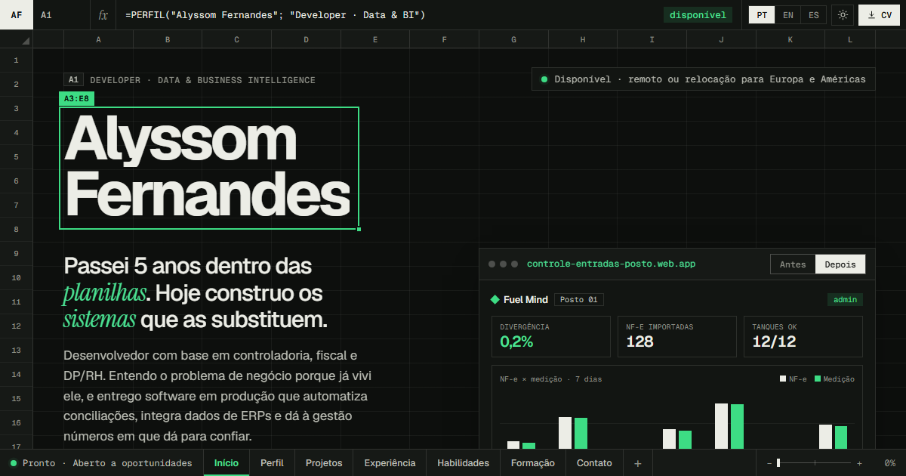

# Portfólio — Alyssom Fernandes

**Site: [alyssom-fernandes.github.io/portfolio](https://alyssom-fernandes.github.io/portfolio/)** · em português, inglês e espanhol

[](https://alyssom-fernandes.github.io/portfolio/)

**PT** — Portfólio de desenvolvedor com base em controladoria, fiscal e DP. A página inteira se comporta
como uma planilha: barra de fórmulas que muda a cada seção, colunas A–L, linhas numeradas, abas no rodapé
como menu e, no topo, uma planilha caótica que vira o dashboard do Fuel Mind. Cada projeto é contado como
problema, solução, arquitetura e resultado, com a tela real da demonstração e os links para a demo e o código.

**EN** — Portfolio of a developer with a background in controllership, tax and payroll. The whole page
behaves like a spreadsheet: a formula bar that changes with each section, columns A–L, numbered rows, sheet
tabs as the menu and, at the top, a messy spreadsheet that turns into the Fuel Mind dashboard. Each project
is told as problem, solution, architecture and result, with a real screen from its demo and links to the
demo and the code.

## Stack

HTML, CSS e JavaScript puros, sem framework e sem dependências. Fontes do Google Fonts. Publicado pelo
GitHub Pages a partir da branch `main`.

## Decisões

- **Sem etapa de build.** O que está no repositório é o que vai ao ar: não há bundler, `node_modules`
  nem passo de compilação para manter.
- **Três idiomas sem biblioteca.** Os textos ficam em `assets/js/i18n.js` (PT, EN e ES, com as mesmas
  chaves). O `index.html` traz o português, que é o que aparece sem JavaScript e para os buscadores. Um
  script curto no `<head>` escolhe o tema e o idioma antes da primeira pintura, para a página não piscar.
- **O CV é a própria página.** O PDF do currículo é o modo de impressão da página (`@media print`),
  gerado nos três idiomas por `scripts/gerar-cv.ps1`, que também gera a `og.png`. Site e CV saem do
  mesmo texto; basta rodar o script depois de mudar um texto.
- **Movimento opcional.** Com `prefers-reduced-motion`, o conteúdo aparece já no lugar, sem contadores,
  sem a fórmula sendo digitada e sem a planilha que se desfaz.
- **Habilidades com evidência.** As habilidades são uma tabela dinâmica (tecnologia × projeto em que foi
  usada), não barrinhas de porcentagem.

## Estrutura

```
index.html            conteúdo da página (texto padrão em português)
assets/css/style.css  todo o visual, incluindo tema escuro e o layout do PDF
assets/js/i18n.js     textos em PT, EN e ES
assets/js/main.js     comportamento (idioma, tema, fórmulas, animações)
assets/img/og.png     imagem que aparece ao compartilhar o link
assets/img/telas/     telas reais das demonstrações dos projetos (WebP)
cv/                   currículo em PDF nos 3 idiomas (gerado pelo script)
scripts/gerar-cv.ps1  gera os PDFs e a og.png a partir da própria página
favicon.svg
```

## Como rodar

Abrir o `index.html` direto funciona, mas o ideal é um servidor local:

```bash
python -m http.server 5173
```

Depois acesse http://localhost:5173 (use `?lang=en` ou `?lang=es` para os outros idiomas).

## Editar textos

1. Procure o texto em `assets/js/i18n.js` e altere nos **três** idiomas (`pt`, `en`, `es`).
2. Se mudar o português, altere também no `index.html`.
3. Rode o script do CV (abaixo) para o PDF acompanhar.

Projetos novos: copie um bloco `<article class="project">` no `index.html`, crie as chaves `p5.*` no
`i18n.js` e, se quiser, adicione uma coluna na tabela dinâmica de habilidades. Os totais da tabela são
calculados sozinhos.

## Gerar o currículo em PDF

```bash
powershell -ExecutionPolicy Bypass -File scripts/gerar-cv.ps1
```

Gera `cv/Alyssom-Fernandes-CV-PT.pdf`, `-EN.pdf`, `-ES.pdf` e `assets/img/og.png`. O botão "Baixar CV"
do site aponta para o PDF do idioma que está aberto.

## Publicar

O GitHub Pages publica a `main` (**Settings → Pages → Branch: main / (root)**). O `og:image`, o `og:url`
e o `canonical` do `index.html` apontam para `https://alyssom-fernandes.github.io/portfolio/`; se o
endereço do site mudar, troque os três.
