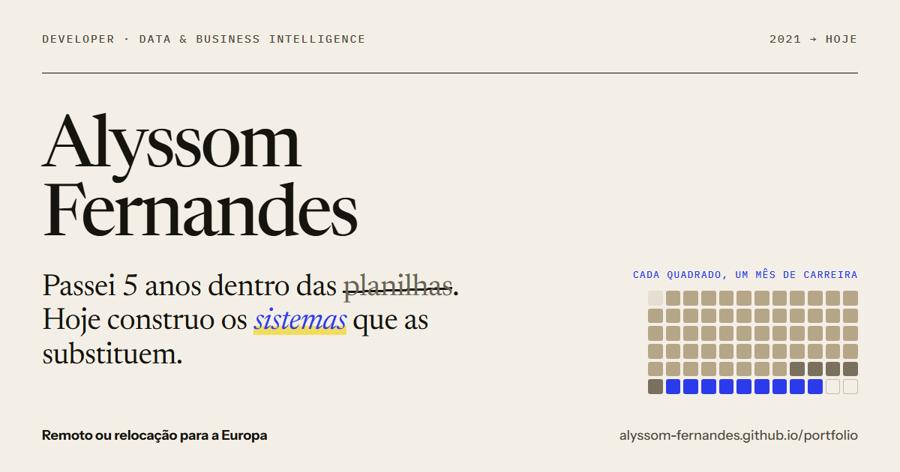

# Portfólio — Alyssom Fernandes

**Site: [alyssom-fernandes.github.io/portfolio](https://alyssom-fernandes.github.io/portfolio/)** · em português, inglês e espanhol

[](https://alyssom-fernandes.github.io/portfolio/)

**PT** — Portfólio de desenvolvedor com base em contabilidade, DP/RH e controladoria. A página começa no papel, com a
trajetória numa grade de meses, e passa para a tela escura nos projetos: nove cartões com as telas reais das demos,
cada um com a sua página de detalhe (origem, problema, sistema, prova e destaques). No contato, volta ao papel.
O currículo em PDF é a própria página impressa.

**EN** — Portfolio of a developer with a background in accounting, payroll and HR, and financial control. The page
starts on paper, with the career shown as a grid of months, and turns into a dark screen for the projects: nine cards
with real screens from the demos, each with its own detail page (origin, problem, system, proof and highlights). The
contact section goes back to paper. The PDF résumé is the page itself, printed.

## Stack

HTML, CSS e JavaScript puros, sem framework. Um gerador em Node (`scripts/gerar-site.mjs`) escreve as páginas a partir
de `fonte/`; a única dependência é o `sharp`, usado para converter as imagens. Fontes Fraunces e Geist hospedadas no
próprio site (`assets/fonts/`, com as licenças OFL). Publicado pelo GitHub Pages a partir da branch `main`.

## Decisões

- **Uma fonte de dados, três idiomas.** Tudo que não é texto fica em `fonte/dados.json`; os textos ficam em
  `fonte/textos.pt.json`, `textos.en.json` (inglês internacional) e `textos.es.json` (espanhol neutro), com as mesmas
  chaves. O gerador falha e lista o que falta se uma chave existir num idioma e não no outro.
- **Conteúdo em HTML.** Todo o texto sai no HTML gerado (legível sem JavaScript e pelos buscadores). O JavaScript só liga
  a rolagem aos efeitos: movimento contínuo, só `transform` e `opacity`.
- **Projetos com o mesmo peso.** Os nove aparecem em cartões iguais; o detalhe fica em `/projetos/<id>/` (e
  `/en/projetos/<id>/`, `/es/projetos/<id>/`), em forma de estudo de caso, com índice lateral, seção técnica e
  transição entre páginas (`@view-transition`).
- **Seção técnica com fonte.** Arquitetura, decisões, um desafio e os testes de cada projeto, escritos só com o que está
  no código ou no README, e cada bloco com links para os arquivos citados no GitHub.
- **O CV é a própria página.** O PDF é o modo impressão (`@media print`), gerado nos três idiomas por
  `scripts/gerar-cv.ps1`, que também gera as imagens de compartilhamento. Site e CV saem do mesmo texto.
- **Números só medidos ou contados.** As contagens (projetos, demos, testes, meses de carreira) são calculadas dos
  dados; os testes trazem a data da conferência.
- **Habilidades com evidência.** Tabela tecnologia × projeto, marcada só com evidência no código ou no CI de cada
  repositório. Nada de barrinha de porcentagem.

## Estrutura

```
fonte/
  dados.json            tudo que NÃO é texto: links, datas, números, projetos, matriz de habilidades, baseUrl
  textos.pt.json        todo o texto do site; textos.en.json e textos.es.json com as mesmas chaves
  tecnico/<id>.<idioma>.json  seção técnica de cada projeto (arquitetura, fluxo, decisões, desafio, testes, fontes);
                        sem o arquivo do idioma, a seção não aparece naquele idioma
  capturas.json         roteiro das capturas de tela das demos (usado por scripts/capturar-telas.mjs)
scripts/
  gerar-site.mjs        gera index.html, en/, es/, as páginas de projeto, robots.txt, sitemap.xml e 404.html → npm run build
  converter-imagens.mjs converte PNG em WebP e atualiza o manifesto                                      → npm run imagens
  capturar-telas.mjs    tira as capturas das demos com o Edge                                            → npm run capturas
  gerar-cv.ps1          gera os PDFs do currículo e as imagens de compartilhamento
assets/
  css/style.css         visual da página, incluindo o modo impressão (o CV)
  css/projeto.css       visual das páginas de projeto (estudo de caso, índice, seção técnica)
  js/main.js            efeitos de rolagem da página inicial (grade de meses, cortinas, cartões, títulos por linha)
  js/projeto.js         índice e efeitos de rolagem das páginas de projeto
  fonts/                Fraunces e Geist (woff2) e as licenças OFL
  img/og-pt|en|es.png   imagem que aparece ao compartilhar o link (uma por idioma)
  img/rubrica.png|webp  rubrica (só o traço): assina o contato e o CV impresso
  projetos/             capturas em WebP + manifesto.json (largura, altura e versão de 960 px)
cv/                     currículo em PDF (PT, EN, ES)
index.html              GERADO — não edite à mão; o mesmo vale para en/, es/, projetos/, robots.txt, sitemap.xml e 404.html
favicon.svg
```

Pastas locais que não vão para o repositório: `_prototipos/`, `_versao-anterior/`, `_source/`, `_criticas-projetos/`,
`node_modules/`.

## Ver no computador

```bash
npm run build
py -m http.server 5173
```

Depois abra http://127.0.0.1:5173. Para ver um estado sem rolar a página, use `?cena=<id>&progresso=<0 a 1>`
(ids: `abertura`, `trajetoria`, `projetos`, `habilidades`, `contato`). A grade de meses é gerada até o mês da
publicação e o navegador completa os meses seguintes; para simular outro mês, use `?hoje=AAAA-MM`.

## Gerar o site

```bash
npm run build
```

Rode sempre que mexer em `fonte/` ou nas imagens. Se algo estiver errado, o gerador **não** grava nada e diz o que
corrigir (chave faltando num idioma, tela que não existe no manifesto, projeto sem campo obrigatório).
`npm run build -- --idiomas pt` gera só os idiomas pedidos; as outras páginas ficam como estavam.

## Textos

Os textos ficam em `fonte/textos.<idioma>.json`, em chaves legíveis (`abertura.linhaFina`, `projetos.fuelmind.frase`...).
Não use HTML. Marcação permitida:

| Escreva        | Vira                                              |
|----------------|---------------------------------------------------|
| `*palavra*`    | ênfase (na tese, o marca-texto em "sistemas")     |
| `**palavra**`  | negrito                                           |
| `~palavra~`    | riscado (usado em "planilhas" na tese)            |
| `{variavel}`   | valor vindo de `dados.json` ou calculado          |

Variáveis úteis: `{empresasClientes}`, `{empresasGrupo}` e `{empresasGrupoBase}` (o mesmo número sem o "+", para
escrever "mais de 20"), `{projetosPublicados}`, `{demosAtivas}`, `{marca}`, `{carreira.zen.periodo}` e os `numeros` de
cada projeto. Na legenda da grade, os meses de cada empresa são os do período exibido (o mês de transição conta para as
duas); o total conta cada mês de calendário uma vez.

## Adicionar um projeto

1. Gere as capturas (veja **Capturas de tela**) para que existam em `assets/projetos/manifesto.json` com a chave
   `"projeto/tela"`.
2. Em `fonte/dados.json`, dentro de `"projetos"`, copie um bloco parecido e ajuste: `id`, `nome`, `ordem`, `cor`,
   `demo` (`{ "url": "...", "ativa": true }`), `codigo`, `stack`, `numeros`, `testes` (contagens conferidas),
   `composicao` (`"celular": "sempre"` mostra o celular por cima da tela no cartão), `telas`, `celular`, `foco`,
   `legenda` (`"demo"` ou `"repositorio"`) e `itens` (destaques ligados a telas; os primeiros com `"vitrine": true`
   dão as telas do cartão). Sem demo hospedada, `comoRodar` (um link por idioma para o README do projeto) vira o
   botão "Como rodar a demo".
3. Em `fonte/textos.<idioma>.json`, dentro de `"projetos"`, crie o bloco do projeto: `frase`, `origem`, `origemLonga`,
   `problema`, `resumo`, `prova`, `cv` e `itens.<id>.titulo` / `itens.<id>.texto`; e em `"alt"` o texto alternativo de
   cada tela.
4. Opcional: escreva `fonte/tecnico/<id>.pt.json` (e `.en.json`, `.es.json`) no formato dos existentes; o gerador
   valida o formato e para com uma mensagem clara se algo estiver errado.
5. Na matriz de habilidades, acrescente o id em `matriz.colunas` e uma marca (0/1) em cada linha, só com evidência no
   código ou no CI do repositório.
6. `npm run build`.

## Imagens e capturas de tela

```bash
npm run imagens                                     # PNG → WebP (com versão de 960 px) e manifesto atualizado
node scripts/capturar-telas.mjs                     # ensaio: PNGs numa pasta em %TEMP%, site intacto
node scripts/capturar-telas.mjs fuelmind            # ensaio de um projeto
node scripts/capturar-telas.mjs fuelmind --gravar   # substitui as imagens do site e o manifesto
```

As capturas vêm das demos ao vivo, pelo roteiro de `fonte/capturas.json`. O script abre o Edge escondido, com um
perfil descartável, e só navega e usa os botões de entrar em modo demonstração: nunca digita, nunca faz login e nunca
envia formulário. Fluxo: ensaio → conferir os PNGs → `--gravar` → `npm run build`. A documentação completa está no
cabeçalho do script.

## Currículo em PDF e imagem de compartilhamento

```powershell
powershell -ExecutionPolicy Bypass -File scripts\gerar-cv.ps1
```

Regenera o site, imprime cada idioma em `cv/Alyssom-Fernandes-CV-PT.pdf` / `-EN.pdf` / `-ES.pdf` (confere se deu
2 páginas A4) e gera `assets/img/og-pt.png`, `og-en.png` e `og-es.png`. Para conferir antes de substituir os PDFs:
`-PastaCv C:\algum\lugar`. Opções: `-SemCv`, `-SemOg` e `-Idiomas pt`.

## robots.txt, sitemap.xml e página 404

O build gera os três na raiz a partir de `site.baseUrl` (`fonte/dados.json`). O sitemap traz as páginas iniciais e as
de projeto nos três idiomas, com `hreflang` e `x-default`. A 404 usa o caminho do `baseUrl` (ex.: `/portfolio/`),
porque o GitHub Pages a serve em qualquer profundidade. Para trocar o endereço do site, mude `site.baseUrl`, rode
`npm run build` e `scripts\gerar-cv.ps1`; para domínio próprio, crie também o arquivo `CNAME`.

## Publicar (GitHub Pages)

1. `npm run build` e, se mudou texto, `scripts\gerar-cv.ps1`.
2. Confira localmente (`py -m http.server 5173`).
3. Commit e push para `main`. O Pages publica a raiz do repositório (o arquivo `.nojekyll` já existe).
